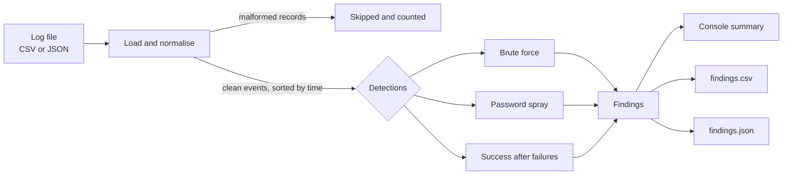
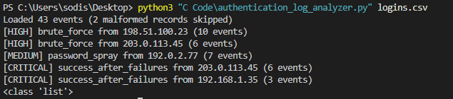

# Authentication Log Analyzer

A Python command-line tool that turns raw authentication logs into actionable security findings. It reads login events from a CSV or JSON file, flags suspicious patterns such as brute force, password spraying and a successful login after repeated failures, and writes the results as CSV and JSON for analyst review.

> **Status:** working prototype built as a learning project. It runs on synthetic data and has no external dependencies.

## Overview

Every login attempt, successful or not, leaves a record. A busy system produces thousands of them, which is far too many for a person to read. Security analysts rely on tooling to surface the handful of events that matter.

This project does that in miniature. It:

1. Loads authentication events from a **CSV or JSON** file into one consistent format.
2. Rejects malformed records safely and **counts** them rather than crashing.
3. Runs **three detections** over the clean events.
4. Prints a short summary and writes **`findings.csv`** and **`findings.json`**.

## Architecture



**Two separate stages.** Cleaning (is this record well-formed?) is kept apart from detection (is this behaviour suspicious?). Detections only ever see validated data, and each stage can be tested on its own.

**Trust boundary.** The input file is treated as untrusted. Every record is validated before use: required fields must exist, the timestamp must parse, the username and IP must be non-empty, and the result must be `success` or `failure`. Anything else is skipped.

### Input format

Both formats use the same fields:

| Field | Description | Example |
| --- | --- | --- |
| `timestamp` | ISO 8601 date and time | `2026-11-08T02:14:01` |
| `username` | Account that was targeted | `admin` |
| `source_ip` | Address the attempt came from | `203.0.113.45` |
| `result` | `success` or `failure` | `failure` |
| `event_type` | Optional label | `ssh_login` |

## Setup

Requires **Python 3.9 or newer**. The analyzer uses only the standard library.

```bash
git clone https://github.com/sidnemani07/auth-log-analyzer.git
cd auth-log-analyzer
```

## Usage

Run it with a CSV or JSON file as the argument:

```bash
python src/authentication_log_analyzer.py sample-data/logins.csv
python src/authentication_log_analyzer.py sample-data/logins.json
```

(On macOS/Linux use `python3`.) Results are written to `output/findings.csv` and `output/findings.json`. Use `-h` for help.

### Run the tests

```bash
pip install -r requirements.txt
python -m pytest
```

The suite has 34 tests covering loading, validation, each detection, threshold boundaries, and report writing.

## Security logic

| Detection | What it looks for | Default threshold | Severity |
| --- | --- | --- | --- |
| **Brute force** | Many failed logins from one IP against one account in a short time | 5 failures within 10 minutes | High |
| **Password spray** | One IP failing against many different accounts, trying a few passwords each | 5 distinct usernames | Medium |
| **Success after failures** | A successful login that follows repeated failures for the same IP and account, which may mean the guess worked | 3 failures within 10 minutes before the success | Critical |

Thresholds are class constants at the top of `LogAnalyzer`, so they are easy to tune.

**Why these three?** They overlap deliberately. A spray avoids the brute-force rule because no single account is hit often, so only the spray detection catches it. A successful login after failures is the highest-priority signal because it suggests an attacker may already be in.

## Evidence

### Sample run

```
Loaded 43 events (2 malformed records skipped)
[HIGH] brute_force from 198.51.100.23 (10 events)
[HIGH] brute_force from 203.0.113.45 (6 events)
[MEDIUM] password_spray from 192.0.2.77 (7 events)
[CRITICAL] success_after_failures from 203.0.113.45 (6 events)
[CRITICAL] success_after_failures from 192.168.1.35 (3 events)
Wrote 5 findings to output/findings.csv and output/findings.json
```

Full sample output is in [`docs/sample_output/`](docs/sample_output/).



### What the sample data contains

The synthetic logs include normal traffic, attacks, near misses and a false positive, so the tests can check both what is flagged and what is not:

| Scenario | Source | Result |
| --- | --- | --- |
| Normal daytime logins | sid, alice, bob, carol | Not flagged |
| One typo, then success | alice | Not flagged |
| 10 failures, no success | `198.51.100.23` → root | Brute force |
| 6 failures, then success | `203.0.113.45` → admin | Brute force and success after failures |
| 7 usernames, 1-2 attempts each | `192.0.2.77` | Password spray |
| Forgot password: 3 failures, then success | dave, `192.168.1.35` | Success after failures (**false positive**) |
| 4 failures only | carol | Not flagged (below threshold) |
| Two malformed records | n/a | Skipped and counted |

## Limitations

- **False positives.** The rules cannot tell a forgetful user from an attacker, as the `dave` case shows. A shared office IP behind NAT could also trip the spray rule. Possible mitigations include treating internal addresses differently or lowering severity for internal sources.
- **Spray detection has no time window.** It counts distinct usernames across the whole file, and its findings have no first or last seen time.
- **Brute-force count.** `count` is the total failures for that IP and account in the file, not only those inside the triggering window.
- **Performance.** `detect_success_after_failures` rescans earlier events for every success, which is fine for thousands of rows but slow for millions. Grouping by IP and account first would fix this.
- **Input assumptions.** It expects the normalised CSV/JSON schema above rather than raw syslog. Timestamps should all use the same convention (all with a timezone offset, or all without), because mixing them breaks time comparison.
- **Skipped records are invisible.** A malformed record that was actually an attack would be dropped, which is why the skipped count is printed.
- **Static thresholds.** There is no baselining, allow-listing or IP reputation enrichment, and no paid services are used.
- **Batch only.** It analyses a file after the fact and does not monitor in real time.

## Future improvements

- Detect unusual source concentration (one IP responsible for a large share of failures).
- Add a time window and timestamps to the spray detection.
- Parse raw `auth.log` / syslog lines directly.
- Group events by IP and account to make detections faster.
- Add configurable thresholds through command-line flags or a config file.

## Lessons learned

- **Separating validation from detection** kept the code easy to reason about and test.
- **Method scope in classes.** I hit two bugs from methods missing `self`, or being called on the class instead of an object. Tracing them taught me how Python passes the instance to a method.
- **Stale copies of a file.** I spent time debugging a fix that "didn't work" because I was running an older copy of the script. Keeping one project folder and checking which file is executing would have saved that time.
- **Test the negatives.** Adding a near-miss, a typo and a known false positive made the thresholds meaningful rather than just flagging everything.

## Ethics and safety

- This is a **defensive** tool for analysing logs. It does not attack or probe any system.
- The bundled data is **synthetic**. The IP addresses come from ranges reserved for documentation (`192.0.2.0/24`, `198.51.100.0/24`, `203.0.113.0/24`) and do not belong to real hosts.
- Only analyse logs from systems you own or are explicitly authorised to review.
- Real logs contain usernames and IP addresses, which can be personal data. Do not commit real logs, credentials or tokens to this repository.

## Project structure

```
auth-log-analyzer/
├── README.md
├── LICENSE
├── requirements.txt
├── pytest.ini
├── .gitignore
├── src/
│   └── authentication_log_analyzer.py
├── tests/
│   └── test_analyzer.py
├── sample-data/
│   ├── logins.csv
│   └── logins.json
├── output/                  # generated results (ignored by git)
└── docs/
    ├── sample_output/       # example findings
    └── screenshots/
```
